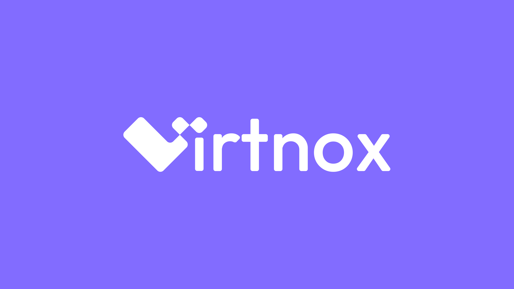

Virtnox Ltd.

---

# Brand Guidelines

Last Updated: 26 November 2026

---

## Contents

1. [Brand Assets](#1-brand-assets)
   - 1.1. [Symbols](#11-symbols)
   - 1.2. [Logotypes](#12-logotypes)
   - 1.3. [Social](#13-social)
2. [Color Palette](#2-color-palette)
3. [Usage Guidelines](#3-usage-guidelines)

---

## 1. Brand Assets

Official vector and raster files for Virtnox.

### 1.1. Symbols

Use the standalone symbols in spaces where the full logotype is too wide.

<table>
  <tr>
    <th>Default Symbol</th>
    <th>Black Symbol</th>
    <th>White Symbol</th>
  </tr>
  <tr>
    <td align="center"></td>
    <td align="center"></td>
    <td align="center"></td>
  </tr>
  <tr>
    <td><code>symbols/virtnox-symbol.svg</code></td>
    <td><code>symbols/virtnox-symbol-black.svg</code></td>
    <td><code>symbols/virtnox-symbol-white.svg</code></td>
  </tr>
</table>

### 1.2. Logotypes

Use the full logotype as the primary brand signature.

<table>
  <tr>
    <th>Default Logotype</th>
    <th>Black Logotype</th>
    <th>White Logotype</th>
  </tr>
  <tr>
    <td align="center"></td>
    <td align="center"></td>
    <td align="center"></td>
  </tr>
  <tr>
    <td><code>logotypes/virtnox-logotype.svg</code></td>
    <td><code>logotypes/virtnox-logotype-black.svg</code></td>
    <td><code>logotypes/virtnox-logotype-white.svg</code></td>
  </tr>
</table>

### 1.3. Social

Pre-styled assets.

<table>
  <tr>
    <th>Icon</th>
    <th>Banner</th>
    <th>YouTube Banner</th>
  </tr>
  <tr>
    <td align="center"></td>
    <td align="center"></td>
    <td align="center"></td>
  </tr>
  <tr>
    <td><code>social/virtnox-icon.png</code></td>
    <td><code>social/virtnox-banner.png</code></td>
    <td><code>social/virtnox-banner-youtube.png</code></td>
  </tr>
</table>

---

## 2. Color Palette

| Role           | Name           | Hex       | RGB                  |
| :------------- | :------------- | :-------- | :------------------- |
| Primary Accent | Virtnox Violet | `#826CFF` | `rgb(130, 108, 255)` |

---

## 3. Usage Guidelines

- **Clear Space:** Maintain padding around any asset equal to at least half the height of the asset.
- **Minimum Size:** There is no fixed minimum size, but ensure assets are visible to the naked eye; use the symbol in small spaces.
- **Modifications:** Do not stretch, rotate, crop, distort or otherwise modify any Virtnox brand asset.
